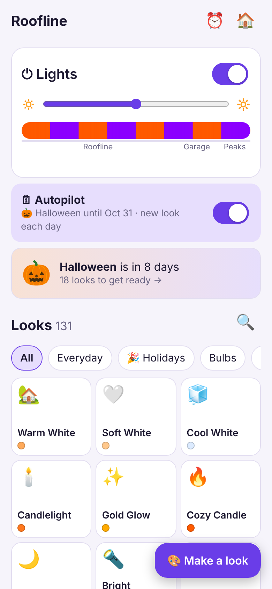
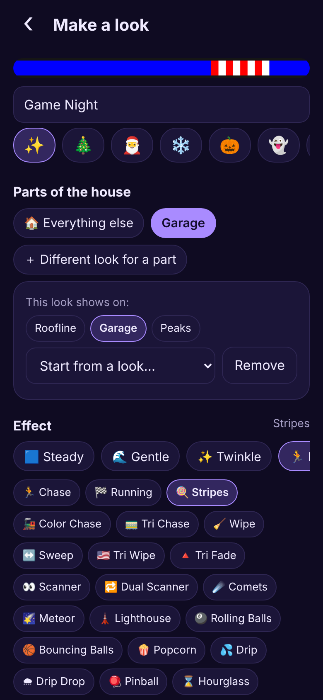
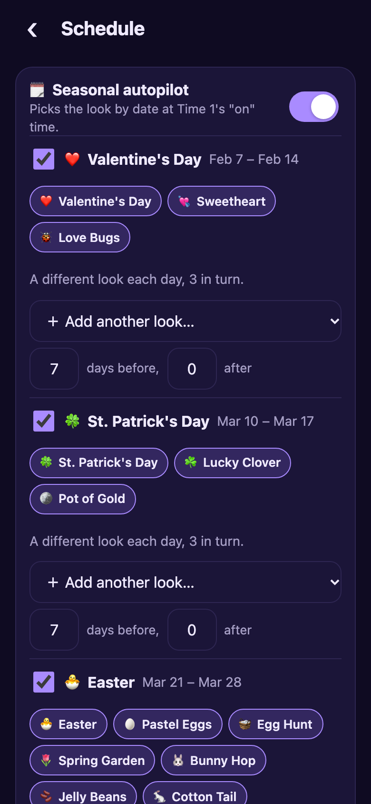

Eaveglow is a simple phone app for WLED that lives on the controller itself. It's one small web page you upload to the ESP32 running WLED, so there's no extra hardware, no cloud account and no app store.

  
  
  

## Install

1. Download `eaveglow.htm.gz` and `eaveglow-icon.png` below.
2. Open `http://<your-controller-ip>/edit` and upload both files. If WLED's settings are PIN-locked, unlock them first.
3. Open `http://<your-controller-ip>/eaveglow.htm` on your phone. On iPhone, use Share > Add to Home Screen.

To update later, upload the new `eaveglow.htm.gz` over the old one. Your settings are kept.

## New in 1.2.0

- **Props on another controller.** Add a second WLED controller under House zones > Props and Eaveglow drives it alongside your roofline. Each controller gets its own part of every look, so layouts and light spacing don't have to match (no WLED Sync needed). Looks, power, brightness, the sleep timer, schedules and autopilot all reach every controller.
- **Candy canes with diagonal stripes.** Upload the cane's xLights model file from the prop maker, pick the stripe colors (red and cool white to start) and width, and the stripes stay put through power cycles, schedules and autopilot.
- **Path lights** that follow the current look, using as many lights of an output as you choose (so arches on the same output are left alone).
- **Brightness per prop**, on top of the overall brightness.

## What's in it

- About 130 ready-made looks, grouped by category and holiday, plus your own custom looks
- House zones (roofline, garage, peaks...) that become WLED segments automatically, with a different look on each part if you want
- Light spacing, like one on and three off, applied across every look
- On/off schedules with several time windows a day, sunrise and sunset by zip code
- Seasonal autopilot: looks change by date for each holiday and can rotate to a different look each day, with an everyday look the rest of the year. It runs on WLED presets and timers, so no phone has to stay open.
- Custom color palettes installed on the controller when a look needs them
- Settings are stored on the controller, so everyone in the house sees the same thing

## Good to know

- Built for WLED 16. WLED 0.15 works too, with fewer timers available for schedules.
- Saving a schedule replaces any timers already set up in WLED.
- Turning on autopilot saves a preset for each look it uses. The lights flash through those looks while saving, then go back to what they were showing.
- About 40 KB gzipped.
